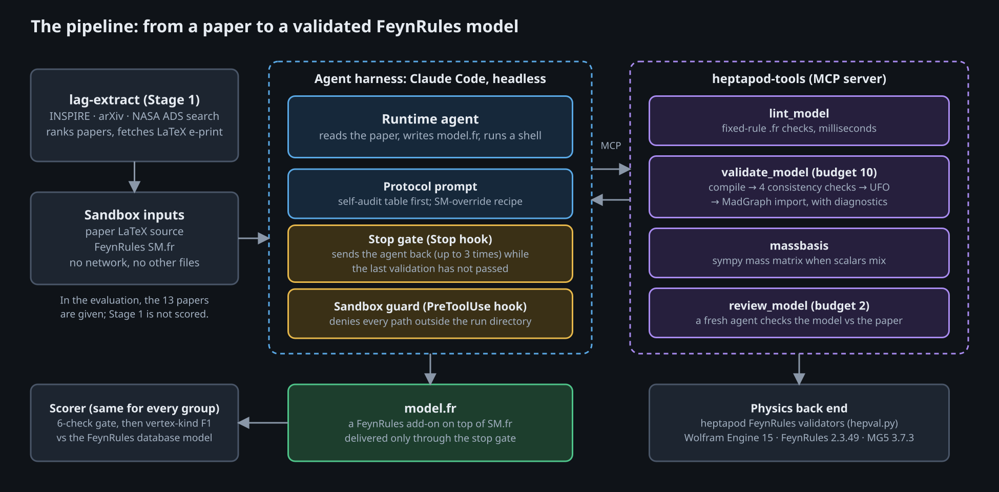
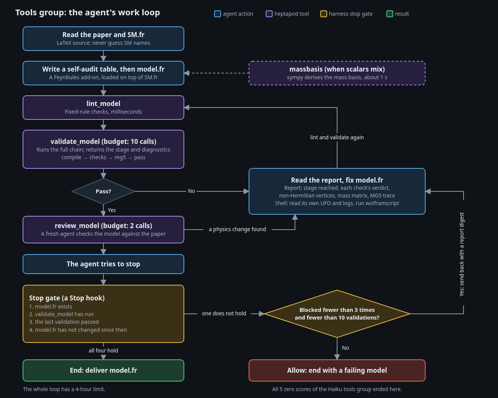
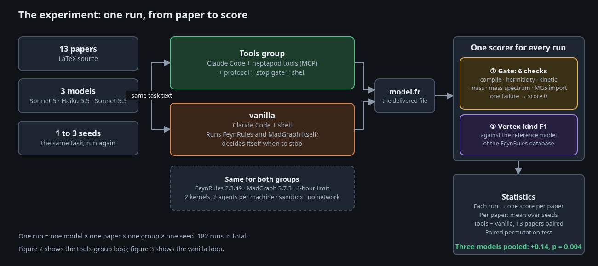
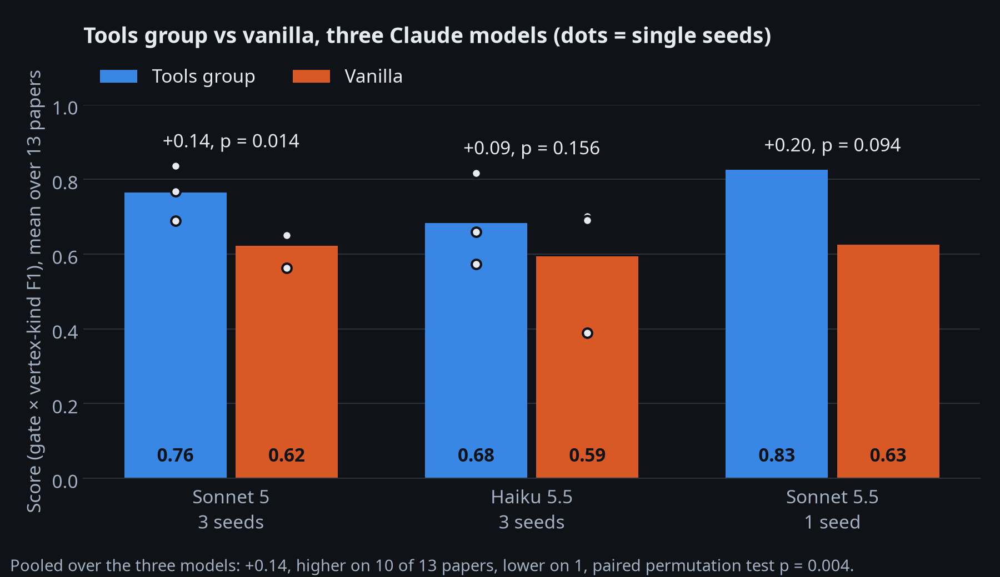
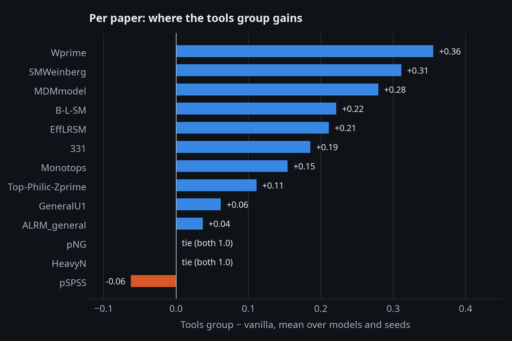
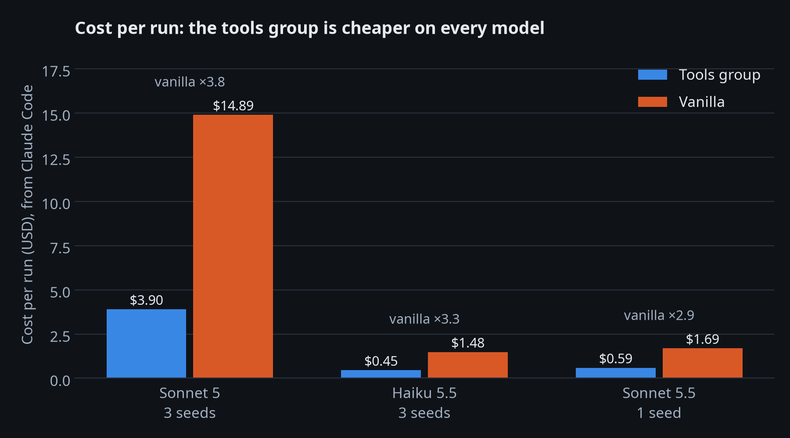

# Can an agent turn a physics paper into a working FeynRules model?

*Google Summer of Code 2026 · ML4SCI · HEPSIM5 — Ken Wu*

> **TL;DR.** I built tools and an agent harness that read a Beyond-Standard-Model (BSM) paper and write its FeynRules model. The physics checks run inside the agent's loop, and the agent cannot stop while its model fails them. On 13 papers from the FeynRules model database, this agent scored higher than the same agent with only a shell, on all three Claude models I tested: **+0.14 on a 0-to-1 score, higher on 10 papers and lower on 1, p = 0.004**, at about a third of the cost. The main open question is whether this holds on papers that I did not use to tune the tools.
>
> Code: [Agentic-Lagrangian-Extraction v0.1.0](https://github.com/KenWuqianghao/Agentic-Lagrangian-Extraction/tree/v0.1.0) · Toolkit: [heptapod](https://github.com/tonymenzo/heptapod) · ML4SCI: [ML4SCI.github.io PR](ML4SCI_PR_URL)

## Background

A BSM paper defines a model with a Lagrangian. For example, the W′ paper [hep-ph/0207290](https://arxiv.org/abs/hep-ph/0207290) writes the coupling of a new charged vector boson to fermions as

$$
\mathcal{L} = \frac{g}{\sqrt{2}}\, \overline{f}_i \gamma_\mu \left( C^R_{f_i f_j} P_R + C^L_{f_i f_j} P_L \right) W'^{\mu} f_j + \mathrm{h.c.}
$$

To compare this model with LHC data, a physicist writes it as a FeynRules model (`.fr`, a Mathematica package). FeynRules derives the Feynman rules and exports a UFO, which event generators such as MadGraph read. This is the W′ model in the FeynRules model database (B. Fuks), shortened:

```mathematica
V[7] == { ClassName -> Wp, SelfConjugate -> False, Mass -> {MWp, 1000.},
          QuantumNumbers -> {Q -> 1}, PDG -> 34, ... }

LWprimeTmp := ExpandIndices[
    gL/Sqrt[2]*(vlbar.Ga[mu].ProjM.CLl.l + uqbar.Ga[mu].ProjM.CLq.dq)*Wp[mu] +
    gR/Sqrt[2]*(vlbar.Ga[mu].ProjP.CRl.l + uqbar.Ga[mu].ProjP.CRq.dq)*Wp[mu],
    FlavorExpand -> {SU2D}];
LWprime := LWprimeTmp + HC[LWprimeTmp];
```

The step from the paper to the `.fr` file is done by hand, and many papers never get a public model file. The errors in this step are often silent. FeynRules drops a term that expands to zero with no message, so a new particle can end up in no vertex while the model still compiles. A physicist review of our agent-written models found an SU(2) contraction missing from a Yukawa term and a charge sign copied from a table with a different convention.

Recent agent systems such as [ColliderAgent](https://arxiv.org/abs/2603.14553) and [MadAgents](https://arxiv.org/abs/2601.21015) already automate parts of this chain. It is easy to make an agent write a `.fr` file that compiles. It is harder to know whether the file is the model in the paper.

## Project goal

The original GSoC plan was a pipeline from a model name to a validated `.fr` file, built as tools in [heptapod](https://github.com/tonymenzo/heptapod), a HEP toolkit for agents. The measurements changed the plan during the summer (see *Challenges and lessons*). The final question is:

> **Given the LaTeX source of a BSM paper, can a general coding agent write a FeynRules model that passes FeynRules' consistency checks, imports into MadGraph, and contains the physics interactions of the paper? Do heptapod's validation tools make it better than the same agent with only a shell?**

## What I built


*Figure 1. The components.*

- **Literature search (`lag-extract`).** Searches INSPIRE, arXiv, and NASA ADS, ranks theory papers, and downloads the LaTeX source. It is not part of the scored evaluation, which uses fixed papers.
- **Validator back end (`hepval.py`).** Runs the full chain on a `.fr` file: FeynRules compilation, four consistency checks (hermiticity, diagonal kinetic terms, diagonal mass terms, mass spectrum), UFO export, and MadGraph import, with heptapod's validators.
- **heptapod-tools, an MCP server.** `lint_model` (fast rule checks), `validate_model` (the full chain with diagnostics, at most 10 calls), `massbasis` (sympy mass matrices), and `review_model` (a fresh agent checks the model against the paper, at most 2 calls).
- **Claude Code harness.** The agent runs headless in a sandbox with only the paper and `SM.fr`. A **stop gate** (a Stop hook) sends it back, up to 3 times, while its last validation has not passed.
- **Evaluation harness.** A vanilla baseline runner, one scorer for every group, and an audit of every shell command for reads of reference files.


*Figure 2. The work loop of the tools group.*

## Evaluation


*Figure 3. One run, from paper to score.*

- **Dataset.** 13 papers from the FeynRules model database, each with one model whose database implementation compiles to a UFO: HeavyN, Top-Philic Z′, pNG, SMWeinberg, EffLRSM, B-L-SM, MDMmodel, Monotops, W′, pSPSS, General U(1), 331, and ALRM.
- **Metric.** A model must pass 6 checks (compile, hermiticity, kinetic terms, mass terms, mass spectrum within 0.1%, MadGraph import), or it scores 0. Then each vertex becomes a *kind*: SM particles by PDG code without generation, new particles by (spin, charge, colour). The score is the F1 between the agent's and the reference's sets of new-physics vertex kinds.
- **Baseline.** *Vanilla* is the same Claude Code with a shell. It can run FeynRules and MadGraph itself, but it has no heptapod tools, no protocol, and no stop gate. Both groups have the same task, toolchain (FeynRules 2.3.49, MadGraph 3.7.3), 4-hour limit, and scorer.
- **Runs.** Sonnet 5 (3 seeds), Haiku 5.5 (3 seeds), Sonnet 5.5 (1 seed): 182 runs. Paired permutation test over the 13 papers.

An example of the metric. The tools group's W′ model (Sonnet 5, seed 1) passed all 6 checks. The paper discusses W′ decays to a right-handed neutrino $\nu_R$, so the agent added one, `NR`, which the reference does not have:

```mathematica
LWpLepton := Block[{mu, lcur},
  lcur = ExpandIndices[
    gRwp NRbar.VCKMWplepR.Ga[mu].ProjP.l Wp[mu] + gLwp vlbar.VCKMWplepL.Ga[mu].ProjM.l Wp[mu] ];
  lcur + HC[lcur]];
```

All 4 reference vertex kinds are present (recall 1.0), and 2 of the agent's 6 kinds are extra (precision 0.67), so the score is 0.80.

## Results

### 1. The tools group scores higher on all three models



| Model              | Tools group | Vanilla | Difference | Papers higher / lower | p         |
| ------------------ | ----------- | ------- | ---------- | --------------------- | --------- |
| Sonnet 5, 3 seeds  | 0.76        | 0.62    | +0.14      | 8 / 1                 | 0.014     |
| Haiku 5.5, 3 seeds | 0.68        | 0.59    | +0.09      | 6 / 2                 | 0.16      |
| Sonnet 5.5, 1 seed | 0.83        | 0.63    | +0.20      | 5 / 2                 | 0.094     |
| **Pooled**         |             |         | **+0.14**  | **10 / 1**            | **0.004** |

### 2. Most of the gain comes from reliability



The tools group passed all 6 checks in **82 of 91** runs; vanilla passed in **68 of 91**. In one vanilla run (W′, Sonnet 5, seed 2), the agent's summary said that all checks passed, but the scorer's mass-spectrum check failed. The stop gate prevents this: the tools-group agent cannot end on its own claim of success.

### 3. The tools group costs about a third as much



All runs cost **$178** for the tools group and **$661** for vanilla (as reported by Claude Code). Vanilla agents read long logs and try many variants; the tools return a short report with the failing stage and its location.

## What this does not show / limitations

- **No held-out test.** I changed the tools after I read the failures on these same 13 papers.
- **The metric checks structure only.** It does not compare coupling values, signs, or Lorentz structures.
- **Small samples.** 13 papers, and 1 seed on Sonnet 5.5. Haiku 5.5 alone is not significant.
- **"Tools" means my harness plus heptapod's validators.** The stop gate and the protocol are not in heptapod yet.
- **Only Claude models.** A single-seed DeepSeek V4.1 Flash run in OpenCode went the other way (tools 0.54, vanilla 0.64), with an unknown serving backend.
- **Possible memorisation.** The reference models are public. The sandbox stops the agent from reading them, but not from remembering them.

## Challenges and lessons

**Check the measurement before the model.** Three times, a defect in my measurement made the agents look better than they were:

| When      | Defect                                                                                                   | Effect                                                                    |
| --------- | -------------------------------------------------------------------------------------------------------- | ------------------------------------------------------------------------- |
| August    | The scorer picked the "total" Lagrangian by its position in the file.                                    | 11 of 28 models compiled only a fragment, which passes checks more easily. |
| September | The check classifier returned "pass" on every branch. Tony Menzo found this in code review.              | Full-chain passes of the repair loop fell from 18 of 19 to 9 of 19.       |
| October   | An audit showed that the August Codex runs could see the reference files.                                | 19 of 28 runs read their own reference, so the August F1 of 0.748 was withdrawn. |

**Read the LaTeX source, not the PDF text.** PDF-to-text extraction split a fraction into separate lines, and two independent agents read the denominator as a factor. One Z′ coupling came out 30% too low.

**Check the model; do not generate it.** My midterm design had the LLM fill a schema and a template write the `.fr`. With that toolkit, agents passed the full chain in 2 of 8 runs, against 4 of 8 without it. Validation inside the agent's loop is what helped.

**An agent's claim of success is not evidence.** Agents reported passes that the scorer did not confirm, and some passed the checks with a new particle in no vertex. The stop gate and the recall part of the metric address these.

## Code and reproducibility

| Where | What | State |
|---|---|---|
| [Agentic-Lagrangian-Extraction](https://github.com/KenWuqianghao/Agentic-Lagrangian-Extraction), tag [`v0.1.0`](https://github.com/KenWuqianghao/Agentic-Lagrangian-Extraction/releases/tag/v0.1.0) | Literature search, harnesses, benchmark, analysis | Merged |
| heptapod (development repository, private) | Background jobs and the provenance ledger, with the arXiv, reverse-reading and INSPIRE-fallback tools | Merged; public in [heptapod v2.13.0](https://github.com/tonymenzo/heptapod) |
| heptapod (development repository, private) | A check that fails a model with a new particle in no vertex; MadGraph import failures located in the UFO and `.fr`; corrected SM-override guidance | Open PR |
| hepbench (private) | The HeavyN pilot task for [toolbench](https://github.com/tonymenzo/toolbench), with 12 more tasks from the benchmark | Open PR |

No code is in an ML4SCI repository; the code is in the ALE repository and in heptapod.

Key files: `cc_harness/` (the harness), `pi_harness/hepval.py` (the validator back end), and `benchmarks/heptapod_ablation/` (`run_vanilla.py`, the scorer `hillclimb/ref_score.py`, and the final numbers in `hillclimb/models_all.json`).

You need Wolfram Engine 15.0, FeynRules 2.3.49 (with the patch for Wolfram 14 or later), MadGraph 3.7.3, Python 3.12 with sympy, and a logged-in Claude Code. For Sonnet 5:

```bash
python pi_harness/hepval.py setup
python cc_harness/run_cc.py run --arm shell --variant cc_sonnet_shell \
    --pages all --model claude-sonnet-5 --seeds 3 --parallel 2
python benchmarks/heptapod_ablation/run_vanilla.py run --variant cc_vanilla_fair \
    --scorer-rules --pages all --model claude-sonnet-5 --seeds 3 --parallel 2
python cc_harness/run_cc.py score --variants cc_sonnet_shell,cc_vanilla_fair --pages all --seeds 3
python benchmarks/heptapod_ablation/hillclimb/ref_score.py \
    --group tools=$PI_HARNESS_RUNS:cc_sonnet_shell --group vanilla=$PI_HARNESS_RUNS:cc_vanilla_fair
```

`hepval.py` builds its validator from the private heptapod development repository, so a full re-run needs access to it today. One Sonnet 5 seed of both groups costs about $240.

## Future work

1. Test both groups on 5 to 8 held-out papers.
2. Move the stop gate and the protocol into heptapod.
3. Merge the benchmark tasks into hepbench, so that anyone can rerun the comparison.
4. Score coupling values, for example with closed-form decay widths.
5. Repeat the comparison with open-weights models.

## Acknowledgements

I thank my mentors Konstantin Matchev, Stephen Mrenna, Tony Menzo, and Ian Pang. Ian and Konstantin reviewed the agent-written models line by line, and Tony's code reviews found the most important bug in my measurements. I also thank ML4SCI for hosting the project and Google Summer of Code for funding it.
